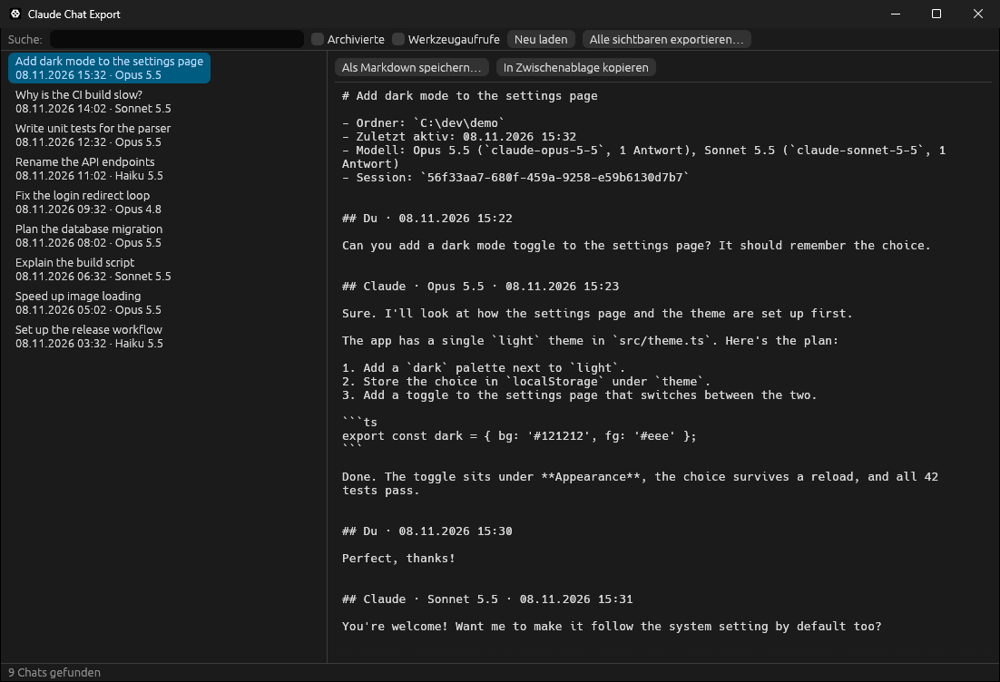
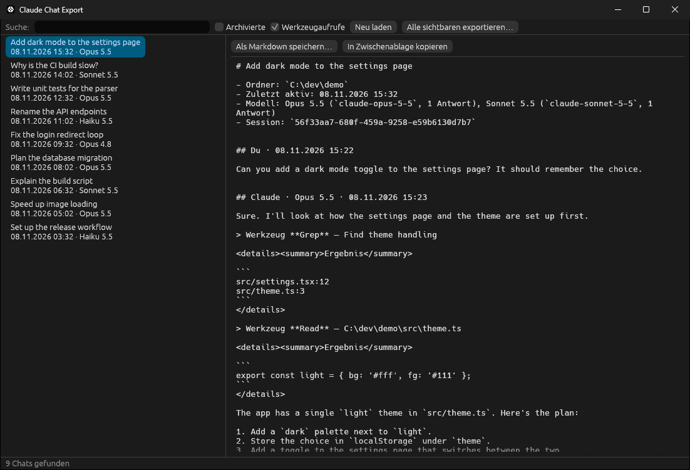

<div align="center">

# cc-chat-export

**Export your Claude desktop Code-tab chats to clean Markdown.**

A small Rust tool with a window UI and a command line.
It only reads local files and sends nothing anywhere.




</div>

## Features

- **Every chat from the Code tab**, with its sidebar title, newest first, archived chats optional
- **Search** by title
- **Live preview** of the Markdown before you save
- **Which model answered:** every Claude reply is headed with its model (Opus 5.5, Sonnet 5.5, ...), switches mid-chat included, and the export header sums up the models used. The chat list shows the model last picked for each chat in the app
- **Export one chat**, **copy it to the clipboard**, or **export all visible chats** into a folder
- **Tool calls optional:** one line per call, with the result shortened inside a collapsible `<details>` block
- **No harness noise:** `<system-reminder>` blocks, task notifications, thinking and sub-agent sidechains are left out, and compacted context is marked
- **Command line** for scripts and backups

<details>
<summary><b>Screenshot with tool calls enabled</b></summary>



</details>

## What the export looks like

````markdown
# Add dark mode to the settings page

- Ordner: `C:\dev\demo`
- Zuletzt aktiv: 08.11.2026 15:32
- Modell: Opus 5.5 (`claude-opus-5-5`, 1 Antwort), Sonnet 5.5 (`claude-sonnet-5-5`, 1 Antwort)
- Session: `56f33aa7-680f-459a-9258-e59b6130d7b7`

## Du · 08.11.2026 15:22

Can you add a dark mode toggle to the settings page? It should remember the choice.

## Claude · Opus 5.5 · 08.11.2026 15:23

Sure. I'll look at how the settings page and the theme are set up first.

> Werkzeug **Grep** — Find theme handling
````

The full sample is in [docs/example-export.md](docs/example-export.md).

## Download

Grab `cc-chat-export-<version>-windows-x64.zip` from the [latest release](https://github.com/Henner4746/cc-chat-export/releases/latest),
unzip it and start `cc-chat-export-gui.exe`. Nothing to install.

The programs are not code-signed, so Windows SmartScreen may warn the first time
(**More info → Run anyway**). Checksums are in `SHA256SUMS.txt`.

## Build from source

You need a Rust toolchain ([rustup.rs](https://rustup.rs)).

```powershell
git clone https://github.com/Henner4746/cc-chat-export
cd cc-chat-export
cargo build --release
```

This builds two programs in `target\release\`:

| Program | What it is |
|---|---|
| `cc-chat-export-gui.exe` | the window shown above |
| `cc-chat-export.exe` | the command line |

## Usage

### Window

Start `cc-chat-export-gui.exe`, pick a chat on the left, then click **Als Markdown speichern…** (save as Markdown) or **In Zwischenablage kopieren** (copy to clipboard).

You can also start it with options:

```
cc-chat-export-gui [--tools] [--open TITLE] [SEARCH]
```

### Command line

```
cc-chat-export [list] [--archived]              list chats with their model, newest first
cc-chat-export <pick> [-o FILE] [--tools]       export one chat (to stdout without -o)
      <pick> = number from the list, session id (a prefix is enough) or part of the title
cc-chat-export --all -o DIR [--archived] [--tools]

--tools     include tool calls and shortened results
--archived  include archived chats
```

Examples:

```powershell
cc-chat-export                                  # list
cc-chat-export 3 -o chat.md                     # third chat in the list
cc-chat-export "dark mode" --tools -o chat.md   # by title
cc-chat-export --all -o backup                  # everything, one file per chat
```

The UI and messages are in German.

## How it works

The Claude desktop app keeps two things per Code-tab chat:

| File | Contains |
|---|---|
| `%APPDATA%\Claude\claude-code-sessions\<account>\<org>\local_*.json` | title, folder, archive flag, CLI session id |
| `%USERPROFILE%\.claude\projects\<project>\<cliSessionId>.jsonl` | the conversation (the Claude Code transcript) |

`cc-chat-export` joins them by session id. If you set `CLAUDE_CONFIG_DIR`, transcripts are read from there.
Chats whose transcript no longer exists are skipped.

These are internal app files, not a public format, so a future app update may change them.

## Screenshots

The screenshots use made-up demo chats. [docs/make-demo-data.py](docs/make-demo-data.py) writes them,
and you can point the app at them like this:

```powershell
python docs/make-demo-data.py demo
$env:APPDATA = "$PWD\demo\AppData"; $env:CLAUDE_CONFIG_DIR = "$PWD\demo\.claude"
.\target\release\cc-chat-export-gui.exe --open "dark mode"
```

## License

[MIT](LICENSE)
